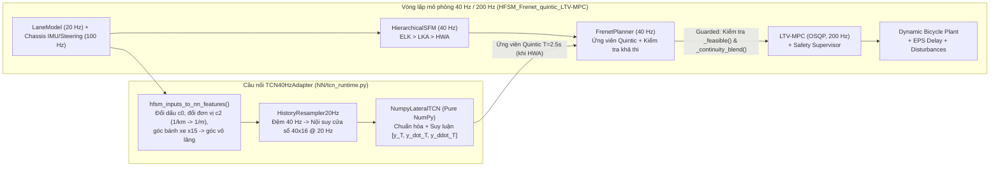

# BÁO CÁO TIẾN ĐỘ: PATH PLANNER FOR LATERAL L2/L2+ ADAS (MODEL-BASED & NEURAL NETWORK INTEGRATION)

**Thư mục dự án:** `C:\Users\PC\Path_planning`  
**Phạm vi báo cáo:**
1. Pipeline quy hoạch & điều khiển model-based: **`HFSM_ Frenet_quintic_ LTV-MPC`**
2. Mạng học sâu từ dữ liệu lái thực tế: **`NN`** (`Polar R-CNN` + `Causal TCN`)
Mục tiêu: ** tích hợp mạng `TCN` vào chạy closed loop `HFSM_ Frenet_quintic_ LTV-MPC`**

---

## 1. Tóm tắt điều hành (Executive Summary)

Dự án phát triển và đối sánh hai hướng tiếp cận cho bài toán hoạch định quỹ đạo ngang (Lateral Path Planning) cấp độ L2/L2+ theo chuẩn **Euro NCAP LSS v4.3 / UNECE R79**, sau đó kết nối chúng thành một kiến trúc lai (Hybrid Architecture):

| Hạng mục | Phương pháp | Trạng thái & Kết quả chính |
| :--- | :--- | :--- |
| **Pipeline Model-based**<br>(`HFSM_ Frenet_quintic_ LTV-MPC`) | Máy trạng thái phân cấp 40 Hz (`ELK > LKA > HWA`) $\rightarrow$ Lấy mẫu đa thức bậc 5 trong tọa độ Frenet $\rightarrow$ Bộ điều khiển LTV-MPC (OSQP native warm-start, 200 Hz) + Safety Supervisor $\rightarrow$ Mô hình xe đạp động lực học có trễ EPS & nhiễu môi trường. | **Hoàn thành & Đạt toàn bộ KPI baseline:** Mô phỏng 18 s (3,601 mẫu), sai số ngang cực đại **0.547 m** (RMS **0.276 m**), thời gian tính p99 của planner **1.05 ms**, controller **1.61 ms**, tỷ lệ supervisor can thiệp **0.0%**, mọi biên dự trữ chất lượng (quality reserves) **$\ge 20\%$**. Đã xây dựng **23 kịch bản chuẩn**, giao diện Web Viewer tương tác và bản nháp C99 (`c_planner/pp_planner.c`). |
| **Pipeline Học sâu**<br>(`NN`) | Dữ liệu thực tế **comma2k19** (407 segments, tách theo route 26/5/6) $\rightarrow$ **Polar R-CNN** (ResNet18 fine-tune) $\rightarrow$ Bộ đệm nhân quả `40 × 16` (2.0 s @ 20 Hz) $\rightarrow$ **Causal TCN** (87,508 tham số) + đầu ra Gaussian NLL dự đoán trạng thái đích sau 2.5 s `[y_T, y_dot_T, y_ddot_T, log_sigma_y]`. | **Hoàn thành huấn luyện, đánh giá & xuất ONNX/NumPy/MATLAB:** Fine-tune Polar R-CNN nâng recall nhận diện đủ 2 vạch lên **86.6%** (sai số trung vị **3.34 px**). Trên tập test độc lập, TCN đạt **Lateral FDE = 0.280–0.290 m** (giảm **66%–67.5%** sai số so với baseline quintic tâm làn **0.860 m**), `coverage_90` đạt **92.6%–92.7%**. Tuy nhiên khi chạy vòng kín độc lập (không có lớp bảo vệ), mạng thô vẫn bị rời làn ở cua gắt. |
| **Tích hợp NN + HFSM**<br>(`tcn_runtime.py` + `eval_hfsm_tcn.py`) | Engine suy luận **Pure-NumPy TCN** (`NumpyLateralTCN`) + Bộ nội suy lịch sử 40 Hz $\rightarrow$ 20 Hz (`HistoryResampler20Hz`) + Chuyển đổi quy ước tọa độ (`TCN40HzAdapter`) nhúng trực tiếp vào `FrenetPlanner` (`TCNHybridPlanner`). | **Hoàn thành tích hợp vòng kín 40 Hz:** Sai số suy luận NumPy so với PyTorch **$< 10^{-5}$**. Khi bật cổng kiểm tra khả thi (`tcn_safe_guarded`), hệ thống sử dụng quỹ đạo TCN trong điều kiện HWA an toàn (54.7% số bước HWA ở kịch bản baseline) và tự động fallback mượt sang Frenet giải tích ở cua gắt (`s01b_sharp_curve`, giảm sai số từ **8.89 m** xuống **0.20 m**, `passed = true`) hoặc khi chuyển sang LKA/ELK. |

---

## 2.Phương pháp, Kiến trúc & Dữ liệu

### 2.1. Model-based HFSM_ Frenet_quintic_ LTV-MPC
* **Kiến trúc phần mềm:** Gói Python tất định `l2_path_planner` (Python $\ge 3.10$, NumPy, SciPy, OSQP, Matplotlib) không phụ thuộc middleware nặng, kèm bản nháp C99 độc lập (`c_planner/pp_planner.c`, `pp_quintic.c`, `pp_frenet.c`).
* **Khối hành vi — Hierarchical State & Function Machine (`HierarchicalSFM`, 40 Hz):**
  * 5 trạng thái hệ thống cấp cao: `OFF`, `STANDBY`, `ACTIVE`, `DEGRADED`, `FAULT`.
  * **Vùng quyết định ngang (Lateral Region):** Phân xử ưu tiên cứng `ELK > LKA > HWA`. Hỗ trợ giữ tâm làn (`HWA_CENTER`), dời tâm né xe tải/vật cản (`OFFSET_LEFT/RIGHT` tối đa $0.30\text{ m}$ nhưng luôn giữ khoảng cách tới vạch $\text{DLC} \ge 0.30\text{ m}$), chuyển làn có chốt (`LANE_CHANGE`), giữ làn (`LKA`), giữ làn khẩn cấp (`ELK` cho vạch liền, mép đường/rào chắn, xe ngược chiều, xe vượt trong điểm mù kể cả khi bật xi-nhan), nhường quyền khi tài xế đánh lái gấp (`DRIVER_OVERRIDE`), khóa thời gian hồi (`cooldown`), và chống trôi theo phần làn mở rộng (`lane_expansion_detected`).
  * **Vùng quyết định dọc (Longitudinal Region):** Điều khiển hành trình thích ứng (ACC), tự động giảm tốc độ mục tiêu trước khúc cua gắt theo độ cong nhìn trước (`preview_curvature_inv_m`) và hệ số ma sát mặt đường ($\mu$), đồng thời nhận giới hạn vận tốc `LateralLimits` từ bộ quy hoạch ngang.
* **Khối ước lượng & Mô hình tín hiệu (`Estimator` & `ChassisSignalModel`):**
  * Mô phỏng bus tín hiệu xe thực tế (IMU yaw rate & $a_y$ ở 100 Hz qua bộ lọc Butterworth bậc 2, tốc độ xe 50 Hz, camera làn đường 20 Hz với độ trễ truyền nhận 30 ms).
  * Ước lượng vận tốc ngang $v_y$, suy diễn vạch làn còn lại khi mất 1 vạch, và duy trì chế độ dự đoán quán tính (coasting) trong $T_{\text{coast}} = 1.0\text{ s}$ khi mất cả 2 vạch trước khi hạ cờ `path_valid = false`.
* **Khối quy hoạch quỹ đạo — Analytic Frenet Quintic (`FrenetPlanner`, 40 Hz):**
  * Sinh tập ứng viên đa thức bậc 5 $d(t) = c_0 + c_1 t + c_2 t^2 + c_3 t^3 + c_4 t^4 + c_5 t^5$ trong hệ tọa độ Frenet $(s, d)$ theo nhiều thời lượng $T$ và độ lệch đích $d_T$.
  * Kiểm tra ràng buộc vật lý theo từng chức năng: ngân sách tổng gia tốc ngang $a_y$ (HWA $2.5$, LKA $3.0$, ELK $4.0\text{ m/s}^2$), gia tốc ngang cộng thêm $a_{y,\text{added}}$ (HWA $0.5$, LKA $1.5$, ELK $3.0\text{ m/s}^2$), độ giật ngang $j_y$ (HWA/LKA $5.0$, ELK $10.0\text{ m/s}^3$), giới hạn góc lái ($0.61\text{ rad}$) và tốc độ quay vô lăng ($6.0\text{ rad/s}$).
  * Hòa trộn liên tục giữa hai chu kỳ liên tiếp (`_continuity_blend`) để đảm bảo độ nhảy vị trí $\le 0.05\text{ m}$, góc hướng $\le 0.005\text{ rad}$, độ cong $\le 0.0003\text{ m}^{-1}$.
* **Khối điều khiển & Mô hình xe (`LTVMPCController` + `DynamicBicycle`, 200 Hz / $\Delta t = 5\text{ ms}$):**
  * **LTV-MPC:** Tuyến tính hóa mô hình xe đạp động lực học quanh vận tốc tức thời, giải bài toán quy hoạch toàn phương (QP) bằng **native OSQP** có tiền cấp phát ma trận và khởi tạo ấm (warm-start). Hỗ trợ chuyển đổi sang backend `cvxpy` hoặc `feedback` qua tham số dòng lệnh `--controller`.
  * **Safety Supervisor:** Lớp bảo vệ độc lập siết biên gia tốc ngang, độ giật, góc lái và tốc độ đánh lái để giữ tối thiểu **20% biên dự trữ thiết kế (design reserve)**.
  * **Mô hình nhiễu vật lý (`DisturbanceModel`):** Gió ngang rối liên tục (turbulent crosswind), lực và mô-men xoắn khí động học, góc nghiêng mặt đường (road bank/camber), vùng mặt đường ướt/trơn ($\mu = 0.5$), và trễ cơ cấu lái trợ lực điện (EPS delay 50–150 ms).

### 2.2. Mô hình học sâu
* **Dữ liệu huấn luyện & Quy trình chống rò rỉ (`build_dataset.py`):**
  * Khai thác bộ dữ liệu lái xe cao tốc thực tế **comma2k19** (camera 20 Hz, IMU 100 Hz, CAN tốc độ/góc lái và quỹ đạo pose 3D).
  * Trích xuất **407 segments** với **416,565 cửa sổ mẫu**. Phân chia nghiêm ngặt theo tuyến đường (**route-level split**: **26 routes train / 5 routes validation / 6 routes test**, seed `2026`), tuyệt đối không chia ngẫu nhiên theo cửa sổ trượt để tránh rò rỉ dữ liệu.
  * Giải mã trạng thái điều khiển (`decode_controls.py`) để lọc bỏ các đoạn có can thiệp điều khiển ngang tự động, đảm bảo nhãn `future_pose` phản ánh đúng hành vi lái của con người.
* **Nhận diện làn đường (`prepare_lanes.py`, `finetune_polarrcnn.py`):**
  * Sử dụng mạng **Polar R-CNN** (backbone ResNet18 tiền huấn luyện trên CULane `models/polarrcnn_culane_r18.pth`), đóng băng backbone và fine-tune các nhánh FPN/RPN/ROI trong 15 epochs trên tập dữ liệu gán nhãn thủ công của comma2k19 (`models/polarrcnn_comma_finetuned_e15.pth`).
* **Hợp đồng dữ liệu (`40 × 16` @ 20 Hz $\rightarrow$ Đích 2.5 s):**
  * **Đầu vào:** Ma trận `40 × 16` (2.0 s lịch sử ở 20 Hz) gồm 16 đặc trưng trong hệ tọa độ xe (trái-dương): hệ số đa thức bậc 3 vạch trái `left_c0..c3`, vạch phải `right_c0..c3`, độ tin cậy `left_conf`, `right_conf`, vận tốc `speed_mps`, `yaw_rate_rps`, `lateral_accel_mps2`, góc vô lăng `steering_angle_rad`, tốc độ đánh lái `steering_rate_rps`, và cờ `perception_validity`.
  * **Đầu ra:** Vector 4 chiều `[y_T, y_dot_T, y_ddot_T, log_sigma_y]` biểu diễn vị trí ngang, vận tốc ngang, gia tốc ngang và độ bất định log-sigma của xe ở thời điểm $T = 2.5\text{ s}$ phía trước.
* **Kiến trúc mạng & Huấn luyện (`tcn_model.py`, `train_model.py`):**
  * **Causal TCN (`LateralPlanningTCN`):** 4 khối tích chập nhân quả giãn nở (dilated causal conv1d) với số kênh `[32, 48, 64, 64]`, hệ số giãn `[1, 2, 4, 8]`, kernel `3`, 2 lớp conv/khối + `ChannelLayerNorm` + kết nối tắt (residual), trường tiếp nhận (receptive field) đạt **61 bước thời gian**, theo sau bởi MLP head `[128, 64, 32]`. Tổng số tham số khả huấn luyện: **87,508 tham số** (dung lượng gọn nhẹ ~338 KB khi nén `.npz`).
  * **Hàm mất mát đa mục tiêu:** Kết hợp **Gaussian NLL Loss** (học đồng thời giá trị kỳ vọng và độ bất định $\sigma_y$), **Lane-Feasibility Loss** (phạt vi phạm biên làn có trọng số theo độ tin cậy trên đường cong quintic tái tạo), và **Teacher Distillation Loss** từ hai nguồn giáo viên:
    1. **Openpilot Supercombo Teacher (`openpilot_teacher.py`):** Chạy offline mô hình `big_driving_supercombo.onnx` với phép chiếu camera ảo và trạng thái hồi quy.
    2. **Constrained Frenet Expert Teacher (`expert_teacher.py`):** Chiếu tối thiểu quỹ đạo người lái vào tập khả thi Frenet/quintic (đã hiệu chỉnh **87,871 / 416,565** mẫu, tức **21.1%** tập dữ liệu có hành vi người lái vượt ngưỡng biên làn hoặc độ giật).

### 2.3. Pipeline Tích hợp (`TCNHybridPlanner` — Nối `NN` vào `HFSM_ Frenet_quintic_ LTV-MPC`)
Để nhúng mạng TCN (vốn hoạt động ở 20 Hz, hệ tọa độ trái-dương) vào vòng lặp thời gian thực 40 Hz của `HFSM_ Frenet_quintic_ LTV-MPC` (hệ tọa độ phải-dương) mà không gây xung đột phụ thuộc hoặc lệch pha, dự án đã xây dựng hai module cầu nối tại `NN/tcn_runtime.py` và `NN/eval_hfsm_tcn.py`:



* **`NumpyLateralTCN`:** Cài đặt toàn bộ phép toán tích chập nhân quả 1D, `ChannelLayerNorm`, hàm kích hoạt ReLU/SiLU và chuẩn hóa đầu vào bằng **NumPy thuần**, loại bỏ hoàn toàn phụ thuộc PyTorch trong quá trình mô phỏng vòng kín.
* **`hfsm_inputs_to_nn_features` & `HistoryResampler20Hz`:**
  * Tự động đồng bộ quy ước dấu và đơn vị: đổi dấu `c0` từ phải-dương sang trái-dương (`c0_nn = -line.c0`), chia `c2_inv_km` cho `1000.0` để về $\text{m}^{-1}$, nhân góc bánh trước với tỷ số truyền lái `steering_ratio = 15.0` để ra góc vô lăng, và xử lý suy giảm độ tin cậy khi mất 1 hoặc 2 vạch làn (`LaneHoldState`).
  * Nhận mẫu ở 40 Hz mỗi chu kỳ planner, nội suy tuyến tính ra cửa sổ `40 × 16` đúng chuẩn 20 Hz và gọi suy luận TCN mỗi 2 bước (`infer_every_n_steps = 2`, tức 20 Hz).
* **`TCNHybridPlanner`:**
  * Luôn cập nhật bộ đệm lịch sử 40 Hz cho TCN ngay cả khi xe đang ở chế độ LKA hoặc ELK (giữ bộ đệm "ấm" liên tục).
  * Khi HFSM kích hoạt `HWA (LANE_CENTER)`, nghiệm đích `[y_T, y_dot_T, y_ddot_T]` của TCN được chiếu từ hệ tọa độ xe sang hệ tọa độ Frenet $(s_T, d_T)$ và dựng thành ứng viên đa thức bậc 5 `Candidate(T=2.5 s)`.
  * Ở chế độ **`guarded=True`**, ứng viên TCN được kiểm tra qua đúng hàm `_feasible()` của `FrenetPlanner`; nếu đạt mọi giới hạn an toàn thì được chọn và làm mượt qua `_continuity_blend()`, nếu vi phạm (ví dụ trong cua gắt vượt ngân sách $a_y$ hoặc lấn biên làn) hệ thống tự động giữ ứng viên Frenet giải tích an toàn.

---

## 3. Kết quả thu được

   **23 file kịch bản chuẩn** trong `HFSM_Frenet_quintic_ LTV-MPC/scenarios/` bao phủ từ `S1` đến `S17` . Toàn bộ **13 bộ kiểm thử `pytest`** kiểm chứng đầy đủ các kịch bản và bơm lỗi cảm biến. (kịch bản tổng hợp dài **18.0 s**, **3,601 mẫu** ở tần số 200 Hz, bao gồm bám làn HWA, nhiễu gió ngang, đường nghiêng, mặt đường trơn trượt và can thiệp LKA):

| Chỉ số đánh giá (KPI) | Giá trị đạt được | Ngưỡng yêu cầu / Mục tiêu | Kết luận |
| :--- | :---: | :---: | :---: |
| **Sai số bám ngang cực đại (`max_abs_lateral_error_m`)** | **0.5467 m** | Không đè vạch ($\le 0.80\text{ m}$) | **ĐẠT** |
| **Sai số bám ngang hiệu dụng (`rms_lateral_error_m`)** | **0.2759 m** | $\le 0.35\text{ m}$ | **ĐẠT** |
| **Rời khỏi làn đường (`lane_departure`)** | **`false` (0 lần)** | `false` | **ĐẠT** |
| **Gia tốc ngang cực đại (`max_abs_lateral_acceleration_mps2`)** | **1.3484 m/s²** | HWA $\le 2.5$ / LKA $\le 3.0\text{ m/s}^2$ | **ĐẠT** |
| **Gia tốc ngang & Jerk trong pha HWA** | $a_y = \mathbf{0.781\text{ m/s}^2}$<br>$a_{y,\text{added}} = \mathbf{0.397\text{ m/s}^2}$<br>$\text{Jerk} = \mathbf{2.072\text{ m/s}^3}$ | $a_y \le 2.5\text{ m/s}^2$<br>$a_{y,\text{added}} \le 0.5\text{ m/s}^2$<br>$\text{Jerk} \le 5.0\text{ m/s}^3$ | **ĐẠT** |
| **Gia tốc ngang & Jerk trong pha LKA** | $a_y = \mathbf{1.348\text{ m/s}^2}$<br>$a_{y,\text{added}} = \mathbf{1.189\text{ m/s}^2}$<br>$\text{Jerk} = \mathbf{3.521\text{ m/s}^3}$ | $a_y \le 3.0\text{ m/s}^2$<br>$a_{y,\text{added}} \le 1.5\text{ m/s}^2$<br>$\text{Jerk} \le 5.0\text{ m/s}^3$ | **ĐẠT** |
| **Thời gian tính Planner p99 (`planner_p99_ms`)** | **1.054 ms** | $\le 5.0\text{ ms}$ (Chu kỳ 25 ms) | **ĐẠT** |
| **Thời gian giải LTV-MPC Controller p99 (`controller_p99_ms`)** | **1.606 ms** | Dự trữ deadline **83.94%** | **ĐẠT** |
| **Tỷ lệ Safety Supervisor phải can thiệp cắt lệnh** | **0.00%** | $\le 10.0\%$ | **ĐẠT** |
| **Biên dự trữ chất lượng (`all_quality_reserves_at_least_20_percent`)** | **Tất cả $\ge 20.6\%$**<br>*(HWA $a_y$: 68.8%, Jerk: 58.6%; LKA $a_y$: 55.1%, Jerk: 29.6%; Steer rate: 20.9%; Hình học làn: 31.7%)* | Mọi hạng mục $\ge 20.0\%$ | **ĐẠT** |


---

### 3.2. Kết quả của Pipeline Học sâu (`NN`)

#### a) Kết quả nâng cấp Nhận diện làn đường (`Polar R-CNN Fine-tuning`)
Triển khai trên **290 khung hình kiểm toán độc lập** (chia theo route 236 train / 23 val / 31 test):

| Chỉ số kiểm toán nhận diện làn (290 frames) | Trước Fine-tune (CULane gốc) | Sau Fine-tune Epoch 15 (`polarrcnn_ft_e15`) | Mức cải thiện |
| :--- | :---: | :---: | :---: |
| **Tỷ lệ nhận diện đủ cả 2 vạch (`both_lane_recall`)** | 75.00% | **86.55%** | **+11.55 điểm %** |
| **Sai số điểm ảnh trung vị (`median_pixel_error`)** | 10.40 px | **3.34 px** | **−67.9%** |
| **Sai số điểm ảnh phân vị 95 (`p95_pixel_error`)** | 65.70 px | **16.01 px** | **−75.6%** |
| **Sai số hình học MAE theo cự ly (10 m / 30 m)** | — | **0.047 m** (@ 10 m) / **0.372 m** (@ 30 m) | Độ chính xác cao vùng gần |

#### b) Kết quả Dự đoán Quỹ đạo 2.5 s trên Tập Test Độc lập (Offline Route-Split Evaluation)
Đánh giá trên 6 tuyến đường test hoàn toàn tách biệt với tập train:

| Phương pháp / Mô hình | Lateral FDE @ 2.5 s (m) $\downarrow$ | Lateral ADE (m) $\downarrow$ | Sai số góc hướng MAE (rad) $\downarrow$ | Coverage 90% (Mục tiêu 85–95%) | P95 $\|a_y\|$ (m/s²) | P95 $\|j_y\|$ (m/s³) | Tỷ lệ vi phạm biên làn (%) $\downarrow$ |
| :--- | :---: | :---: | :---: | :---: | :---: | :---: | :---: |
| **Baseline: Constant Curvature** | 1.1324 | 0.4346 | 0.0322 | 72.86% | 2.034 | 5.333 | 22.56% |
| **Baseline: Lane-Center Quintic** | 0.8517 – 0.8596 | 0.2742 – 0.2923 | 0.0373 | 81.08% – 83.83% | 1.920 | 7.994 | **0.19% – 0.54%** |
| **TCN (`tcn_lane_safe` — Raw Network)** | **0.2895** *(−66.3%)* | **0.1326** | **0.0118** | **92.70%** | **1.864** | 5.517 | 5.50% *(Stay-lane: 1.73%)* |
| **TCN (`tcn_lane_safe` + Offline Safety Shield)** | 0.3293 *(−61.3%)* | 0.1530 | 0.0124 | **90.99%** | 2.007 | 5.843 | **0.40%** |
| **TCN (`tcn_frenet_expert_v2` — Raw Network)** | **0.2797** *(−67.5%)* | **0.1279** | **0.0114** | **92.56%** | **1.937** | 5.599 | 9.56% *(Stay-lane: 2.44%)* |

* **Pros**
  * Mạng Causal TCN (87,508 tham số) học rất tốt hành vi đặt vị trí xe của người lái thật: giảm **66.3% đến 67.5% sai số vị trí đích (FDE)** tại 2.5 s so với phương pháp bám tâm làn hình học (`0.280 m` so với `0.860 m`), kể cả trong điều kiện thiếu sáng (`dark` slice: FDE **0.305 m**), tốc độ cao (`high_speed`: FDE **0.325 m**), tốc độ thấp (`low_speed`: FDE **0.102 m**), hay khi mất 1 vạch làn (`one_lane_missing`: FDE **0.343 m**).
  * Đầu ra bất định $\sigma_y$ được hiệu chuẩn tốt (`coverage_90` đạt **92.6%–92.7%**, nằm chính giữa dải yêu cầu 85%–95%).
* **Cons**
  * Tuy nhiên, khi chạy **vòng kín độc lập trên MATLAB** (`NN/artifacts/closed_loop/summary.json`) không có bộ lọc khả thi Frenet/HFSM, mạng TCN thô tuy đạt thời gian suy luận rất nhanh (**trung bình 3.35 ms, p95 3.95 ms**) và bám được đường thẳng (`LaneDepartureFraction = 1.66%`), nhưng bị trôi khỏi làn trên đường cong (`HWA_nominal_curve`: rời làn 58.9%) và các pha khôi phục LKA/ELK (rời làn 49.4%–73.4%). Nguyên nhân là mạng chỉ được học từ dữ liệu lái bình thường và thiếu cơ chế ràng buộc cứng khi trạng thái xe đi vào vùng biên.

---

### 3.3. Kết quả khi nối `NN` vào `HFSM_ Frenet_quintic_ LTV-MPC` (`eval_hfsm_tcn.py`)
Để khắc phục hạn chế của mạng TCN thô khi chạy vòng kín nhưng vẫn tận dụng được quỹ đạo mượt giống người lái của TCN trong chế độ HWA, `TCNHybridPlanner` kết nối `TCN40HzAdapter` vào `FrenetPlanner`. Dưới đây là kết quả thực nghiệm đối sánh 4 chế độ trên cùng bộ điều khiển LTV-MPC (OSQP):

| Kịch bản kiểm thử | Chế độ Planner (`mode`) | Sai số ngang Max (m) | Số bước HWA (`hwa_steps`) | Số bước TCN khả thi (`tcn_feas`) | Số bước TCN được dùng (`tcn_used`) | Supervisor can thiệp (%) | Đạt tiêu chí (`passed`) |
| :--- | :--- | :---: | :---: | :---: | :---: | :---: | :---: |
| **`baseline`**<br>*(18 s: HWA + Gió ngang + Đường trơn + LKA)* | `frenet_baseline` | 0.6499 | — | — | — | 0.0% | **PASS (`true`)** |
| | **`tcn_safe_guarded`** | **0.7624** | 179 | 98 (54.7%) | **98** | **0.0%** | **PASS (`true`)** |
| | `tcn_safe_raw_hwa` | **0.5719** | 103 | 66 | 103 | 0.0% | **PASS (`true`)** |
| | `tcn_exp_raw_hwa` | **0.5964** | 119 | 75 | 119 | 0.0% | **PASS (`true`)** |
| **`s01_hwa_curve`**<br>*(HWA bám cua tốc độ cao)* | `frenet_baseline` | **0.5655** | — | — | — | 0.0% | **PASS (`true`)** |
| | `tcn_safe_guarded` | 2.1485 | 561 | 20 | 20 | 0.0% | FAIL (`false`) |
| | `tcn_safe_raw_hwa` | 12.6454 | 561 | 20 | 561 | 0.0% | FAIL (`false`) |
| | `tcn_exp_raw_hwa` | 12.7721 | 561 | 19 | 561 | 0.0% | FAIL (`false`) |
| **`s01b_sharp_curve`**<br>*(HWA cua gắt vượt $a_{y,\max}$, giảm tốc ACC)* | `frenet_baseline` | 0.0338 | — | — | — | 0.0% | **PASS (`true`)** |
| | **`tcn_safe_guarded`** | **0.1998** | 801 | 44 (5.5%) | **44** | **0.0%** | **PASS (`true`)** |
| | `tcn_safe_raw_hwa` | 8.8934 | 801 | 38 | 801 | 0.0% | FAIL (`false`) |
| | `tcn_exp_raw_hwa` | 9.4077 | 801 | 36 | 801 | 0.0% | FAIL (`false`) |
| **`s04_lka_drift`**<br>*(Trôi làn đường thẳng $\rightarrow$ LKA cứu làn)* | `frenet_baseline` | 0.7547 | — | — | — | 0.0% | **PASS (`true`)** |
| | **`tcn_safe_guarded`** | **0.7547** | 0 | 0 | **0** *(LKA nắm quyền)* | **0.0%** | **PASS (`true`)** |
| | `tcn_safe_raw_hwa` | 0.7547 | 0 | 0 | 0 | 0.0% | **PASS (`true`)** |
| | `tcn_exp_raw_hwa` | 0.7547 | 0 | 0 | 0 | 0.0% | **PASS (`true`)** |


---

## Hướng dẫn chạy Visual Demo


### A. Với Pipeline `HFSM_ Frenet_quintic_ LTV-MPC`

#### Bước 1: Cài đặt môi trường (chỉ cần chạy lần đầu)
Mở PowerShell và di chuyển vào thư mục `HFSM_ Frenet_quintic_ LTV-MPC`:
```powershell
cd "C:\Users\PC\Path_planning\HFSM_ Frenet_quintic_ LTV-MPC"
python -m pip install -e ".[test]"
```

#### Bước 2: Chạy mô phỏng toàn bộ kịch bản và xuất dữ liệu cho Web UI
```powershell
python -m l2_path_planner ui --all --controller feedback
```
*(Lưu ý: Dùng `--controller feedback` giúp xuất nhanh toàn bộ bộ kịch bản chỉ trong vài chục giây để chuyển đổi qua lại trên menu thả xuống của Web UI; dùng `--controller auto` sẽ chạy bộ giải OSQP cho từng kịch bản).*

#### Bước 3: Khởi động Web Server và mở giao diện Demo tương tác
Trong cùng thư mục `HFSM_ Frenet_quintic_ LTV-MPC`, khởi chạy server chống lưu cache:
```powershell
python ui/server.py
```
* Mở trình duyệt web và truy cập địa chỉ: **`http://127.0.0.1:8765/ui/index.html`**
* **Thao tác trên giao diện:**
  * Chọn bất kỳ kịch bản nào ở ô **Scenario** (menu thả xuống góc trên bên phải).
  * Nhấn **▶ Play** (hoặc kéo thanh trượt **Timeline scrubber**) để xem xe di chuyển, quỹ đạo dự kiến (planned trajectory), vạch làn đường, các phương tiện xung quanh (xe tải, xe ngược chiều) và các sự kiện đổi trạng thái HFSM trên thanh sự kiện.
  * Quan sát 3 đồ thị động phía dưới: **Speed & target speed**, **Lateral error & lane margin**, và **Steering command & lateral accel**.

---

### B. Với Pipeline khi nối `NN` (`TCNHybridPlanner`) vào `HFSM_ Frenet_quintic_ LTV-MPC`

#### Bước 1: Chạy toàn bộ kịch bản có nối NN và nạp thẳng vào Web UI
Mở PowerShell và di chuyển vào thư mục `NN`:
```powershell
cd "C:\Users\PC\Path_planning\NN"
python eval_hfsm_tcn.py --all --mode tcn_safe_guarded --controller feedback
```
*(Lệnh sẽ chạy toàn bộ bộ kịch bản với `TCNHybridPlanner` và xuất toàn bộ vào `HFSM_ Frenet_quintic_ LTV-MPC/ui/data/<id>.js`. Bạn có thể đổi `--mode tcn_safe_raw_hwa` nếu muốn xem TCN thuần không bật cổng lọc Frenet, hoặc đổi `--controller auto` để chạy bộ giải OSQP).*

#### Bước 2: Xem mô phỏng trực quan tất cả kịch bản trên trình duyệt
* Nếu server `python ui/server.py` ở Phần A đang chạy, bạn chỉ cần **F5 (Reload)** trang **`http://127.0.0.1:8765/ui/index.html`** và chọn kịch bản bất kỳ trên ô **Scenario** để xem ngay chuyển động của xe khi có mạng TCN điều khiển.
* Nếu chưa bật server, chạy lệnh:
  ```powershell
  cd "C:\Users\PC\Path_planning\HFSM_ Frenet_quintic_ LTV-MPC"
  python ui/server.py
  ```
  rồi mở **`http://127.0.0.1:8765/ui/index.html`**.

#### Bước 3: Chạy bảng benchmark đối sánh toàn diện 4 chế độ (Frenet vs. TCN Guarded vs. TCN Raw)
Để tái lập bảng số liệu so sánh 16 lượt chạy (4 kịch bản $\times$ 4 chế độ planner) ngay trên terminal:
```powershell
cd "C:\Users\PC\Path_planning\NN"
python eval_hfsm_tcn.py
```

#### Bước 4: Xem / Chạy lại Demo vòng kín độc lập của TCN trên MATLAB (Tùy chọn)
Ảnh tổng hợp đối sánh 6 kịch bản vòng kín giữa `TCN_raw` và `Frenet_baseline` trên MATLAB đã được xuất sẵn tại `NN/artifacts/closed_loop/scenario_comparison.png`:
```powershell
Invoke-Item "C:\Users\PC\Path_planning\NN\artifacts\closed_loop\scenario_comparison.png"
```
Nếu máy có cài đặt MATLAB và muốn chạy lại kịch bản mô phỏng MATLAB từ đầu:
```powershell
cd "C:\Users\PC\Path_planning\NN"
python export_matlab_tcn.py artifacts\tcn_lane_safe\tcn.pt
matlab -batch "addpath('matlab'); validate_tcn_parity('artifacts/tcn_lane_safe/lateral_tcn_weights.mat'); run_tcn_closed_loop_scenarios;"
```

---